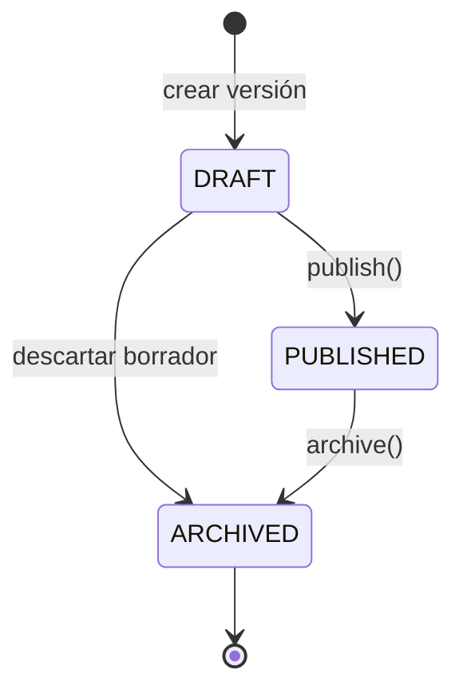

# Plan de implementación — Gestión de Plantillas (slice `templates`)

> Documento de diseño para revisión. Fuentes de verdad: [`architecture-slices.md`](../architecture-slices.md), [`architecture-scaffolding.md`](../architecture-scaffolding.md) y las historias US-TPL de [`epic-template-management.md`](../specs/epic-template-management.md).

---

## 1. Objetivo y alcance

Construir el primer componente de negocio del servicio: el **modelo de datos y la gestión de plantillas de notificación**, sobre persistencia SQLite (posteriormente migrable a una BD más robusta).

**En alcance (esta iteración)**

| Capacidad | Historia de referencia |
|---|---|
| Gestión de plantillas (creación, edición por versiones) | US-TPL-01, US-TPL-03 |
| Asociación de marcadores (variables dentro de la plantilla) | US-TPL-05 |
| Publicación de plantillas (ciclo de vida de versiones) | Decisión de diseño §2 |
| Consultar una plantilla (detalle con versiones y marcadores) | US-TPL-02 (parcial) |
| Preview de una plantilla con variables (render + diagnóstico) | US-TPL-05/06 (parcial) |
| Independencia de formato: plantilla canónica en JSON convertible a html, md, json | US-TPL-06 |

**Fuera de alcance (siguientes iteraciones):** archivado/reactivación (US-TPL-04), búsqueda con filtros (US-TPL-02 completo), render para el Sistema de Despacho (US-TPL-06 completo), trazabilidad (US-TPL-07), métricas (US-TPL-08), autenticación/autorización.

---

## 2. Decisiones cerradas

| Decisión | Detalle |
|---|---|
| Persistencia | **SQLite + JPA** (Spring Data), detrás del puerto `TemplateRepository`; migrar a otra BD toca solo `adapters/out/` |
| Contenido de la plantilla | **JSON canónico**; la conversión al formato final (html, md, json) está desacoplada de la gestión |
| Publicación | Ciclo de vida de versión **DRAFT → PUBLISHED → ARCHIVED**; **una sola versión vigente por plantilla**: publicar una versión archiva automáticamente la anterior. Solo versiones publicadas son usables por campañas nuevas; las referencias a versiones concretas conservan su contenido (US-TPL-03.3) |
| Preview | **Render + diagnóstico**: renderiza lo que puede y lista marcadores requeridos faltantes y opcionales sin datos; **no falla** |
| Separación de modelos | Modelo de dominio ≠ modelo JPA; traducción bidireccional mediante mappers en `adapters/out/` |
| Enfoque de desarrollo | **TDD en el dominio**: primero las pruebas de entidades y agregados, luego el código |
| Estilo de código | Clean code (8 tips), principios SOLID, patrones GoF |
| Estilo de tests | Prácticas de unit testing del artículo de Milan Jovanovic (§3.4) |

---

## 3. Convenciones de calidad aplicadas

### 3.1 Clean code (8 tips)

| Tip | Aplicación en este diseño |
|---|---|
| 1. Early return | Guard clauses en casos de uso y métodos de dominio; sin anidamiento profundo |
| 2. Merge if statements | Preconditions compuestas consolidadas en una sola condición |
| 3. Código conciso | Expresiones de streams en Java para colecciones; legibilidad por delante |
| 4. Métodos descriptivos | Condiciones extraídas: `isPublishable()`, `hasMissingRequiredMarkers()`, `isCurrentVersion()` |
| 5. Excepciones personalizadas | `TemplateNotFoundException`, `DuplicateTemplateException`, `InvalidVersionTransitionException`, `MissingRequiredMarkerException` (con contexto: id, versión, marcador). `MissingRequiredMarkerException` se lanza al guardar con marcador `required` ausente (US-TPL-05.2) y en el render real futuro (US-TPL-06.2); el preview no lanza |
| 6. Constantes | Sintaxis de marcador, límites de longitud — sin números mágicos |
| 7. Enums (sin strings mágicos) | `ChannelType`, `VersionStatus`, `OutputFormat` |
| 8. Result object | `PreviewResult` (resultado + diagnóstico) con constructor privado y fábricas estáticas |

### 3.2 SOLID

| Principio | Aplicación |
|---|---|
| **SRP** | Un caso de uso = una operación; el mapper solo mapea; el servicio de render solo interpola |
| **OCP** | Strategy de conversión de formato: añadir `html`/`md` sin tocar el dominio |
| **LSP** | Cualquier implementación de `TemplateRepository` o `TemplateOutputConverter` es sustituible |
| **ISP** | Puertos pequeños y separados: `TemplateRepository` ≠ `TemplateOutputConverter` |
| **DIP** | `application/` depende de `ports/`; los adaptadores implementan los puertos; `domain/` sin dependencias |

### 3.3 Patrones GoF

| Patrón | Dónde |
|---|---|
| **State** | Ciclo de vida de `TemplateVersion`: DRAFT → PUBLISHED → ARCHIVED (transiciones validadas) |
| **Strategy** | Conversores de formato de salida (`JsonOutputConverter`, `HtmlOutputConverter`, …) |
| **Repository** | `TemplateRepository` (puerto de persistencia) |
| **Factory** | Fábricas estáticas de dominio (`Template.create(...)`, `PreviewResult.of(...)`) |
| **Builder** | Test data builders (`TemplateBuilder`, `TemplateVersionBuilder`) |
| **Adapter** | `JpaTemplateRepository` (salida) y `TemplateController` (entrada) — coherente con la arquitectura de slices |

### 3.4 Estrategia de tests

Un buen test es **rápido, aislado, repetible y auto-validado**, y verifica **un comportamiento lógico** del código propio.

1. **Estructura AAA** en cada test: `// Arrange` / `// Act` / `// Assert` (Given/When/Then).
2. **Nombre de test**: `Method_Scenario_ExpectedResult` (p. ej. `publish_WhenVersionIsDraft_MarksVersionAsPublished`). Una convención, aplicada de forma consistente.
3. **Un comportamiento por test**: varias aserciones sobre el mismo resultado están bien; dos comportamientos en un test, no.
4. **Asertores de dominio**: aserciones legibles sobre estados y resultados; sin verificar interacciones (`verify(times(1))`) — se asertan **resultados**, no detalles de implementación.
5. **Test data builders**: `new TemplateBuilder().WithEmailChannel().WithContent(...).Build()`; los tests no construyen agregados a mano con 6 argumentos.
6. **Mocks solo en fronteras**: repositorios, conversores externos. **Nunca** se mockean objetos de dominio — se instancian reales. Si un test necesita muchos mocks, la clase está acoplada: refactorizar.
7. **Tests parametrizados** (`@ParameterizedTest` + `@CsvSource`/`@MethodSource`) para matrices de validación (marcadores faltantes, transiciones inválidas, canales).
8. **Espejo de estructura**: `src/test/java/...` replica `src/main/java/...`; una clase de test por clase de origen (`TemplateTest` para `Template`).
9. **No se testea**: configuración JPA ni mapeo de entidades en unit tests (eso va en tests de integración), DTOs triviales, comportamiento de Spring/third-party.

---

## 4. Diseño de dominio (capa más interna — solo JDK)

### 4.1 Modelo

**Kernel compartido** (`domain/`): `ChannelType` (enum: `EMAIL`, `WHATSAPP`, `SMS`, `PUSH`) — definición compartida según AGENTS.md.

**Slice `features/templates/domain/`** (agregado `Template`):

| Tipo | Elemento | Responsabilidad |
|---|---|---|
| Entidad (raíz) | `Template` | Identidad, nombre, canal, ciclo de vida del agregado, colección de versiones; garantiza unicidad de número de versión y la versión vigente |
| Entidad | `TemplateVersion` | Número de versión, contenido (`TemplateContent`), estado (State), marcadores, autor y fecha |
| VO | `TemplateContent` | JSON canónico; valida que es JSON válido; extrae marcadores `{{nombre}}` del contenido |
| VO | `TemplateMarker` | Nombre del marcador + indicador `required` |
| VO | `PreviewResult` | Resultado del preview: contenido renderizado + diagnóstico (faltantes requeridos, opcionales sin datos) — Result Object (tip 8) |
| Enum | `VersionStatus` | `DRAFT`, `PUBLISHED`, `ARCHIVED` |
| Servicio de dominio | `TemplateRenderService` | Interpolación de variables en el JSON y cálculo del diagnóstico (puro, sin dependencias) |

**Invariantes de dominio** (cubiertas por tests TDD):

1. `Template.create` genera la versión 1 en `DRAFT` con los marcadores extraídos del contenido (US-TPL-01.3).
2. No puede existir más de una plantilla con el mismo nombre + canal (US-TPL-01.4; se valida contra repositorio vía caso de uso).
3. Editar el contenido crea una versión nueva numerada secuencialmente; la versión anterior permanece íntegra y consultable (US-TPL-03.1). **Desviación acordada de US-TPL-03.2**: la versión más reciente no queda vigente al crearse, sino al publicarse (consecuencia del ciclo DRAFT→PUBLISHED elegido).
4. Toda versión nueva hereda por defecto la marca `required` de los marcadores que conserva, y esas marcas son **editables antes de guardar** mediante overrides explícitos (US-TPL-05.4).
5. Un marcador declarado `required` debe aparecer en el contenido; si no, la operación se rechaza identificando la variable (US-TPL-05.2).
6. Solo un `DRAFT` puede publicarse; publicar fija la versión como vigente y **archiva automáticamente la versión publicada anterior** — exactamente una vigente por plantilla (State pattern). Las referencias existentes a una versión concreta no se ven afectadas (US-TPL-03.3).
7. El render/preview nunca modifica plantilla ni versiones (US-TPL-06.4).

### 4.2 Máquina de estados de `TemplateVersion`



Transiciones inválidas (p. ej. `PUBLISHED → DRAFT`, `ARCHIVED → PUBLISHED`) lanzan `InvalidVersionTransitionException`. A nivel de plantilla, al publicar una versión la vigente anterior pasa automáticamente a `ARCHIVED` (una sola vigente).

### 4.3 Preview (render + diagnóstico)

`TemplateRenderService.preview(content, markers, variables)` devuelve `PreviewResult`:

- **Render**: sustituye `{{marcador}}` por el valor de la variable (valores escapados como JSON para no romper el JSON resultante).
- **Diagnóstico** (el preview **no falla**):
  - `missingRequired`: marcadores requeridos sin variable asociada.
  - `emptyOptional`: marcadores opcionales sin datos (sustituidos por valor neutro, p. ej. cadena vacía).
- Variables aportadas que no corresponden a ningún marcador se reportan como `unusedVariables` (diagnóstico auxiliar, sin impedir el render).

---

## 5. Diseño de persistencia (SQLite + JPA, en `adapters/out/`)

### 5.1 Modelo de datos (tablas)

```sql
template(
  id            TEXT PRIMARY KEY,
  name          TEXT NOT NULL,
  channel       TEXT NOT NULL,          -- enum ChannelType
  status        TEXT NOT NULL,          -- ACTIVE | ARCHIVED
  created_at    TEXT NOT NULL,
  UNIQUE(name, channel)
)

template_version(
  id            TEXT PRIMARY KEY,
  template_id   TEXT NOT NULL REFERENCES template(id),
  version_number INTEGER NOT NULL,
  content_json  TEXT NOT NULL,          -- JSON canónico
  status        TEXT NOT NULL,          -- DRAFT | PUBLISHED | ARCHIVED
  created_by    TEXT NOT NULL,
  created_at    TEXT NOT NULL,
  UNIQUE(template_id, version_number)
)

template_marker(
  id                   TEXT PRIMARY KEY,
  template_version_id  TEXT NOT NULL REFERENCES template_version(id),
  name                 TEXT NOT NULL,
  required             INTEGER NOT NULL,
  UNIQUE(template_version_id, name)
)
```

Migración inicial con Flyway: `V1__create_template_schema.sql`.

### 5.2 Separación dominio ↔ JPA

| Modelo JPA (`adapters/out/`) | Modelo de dominio |
|---|---|
| `TemplateEntity`, `TemplateVersionEntity`, `TemplateMarkerEntity` (anotaciones JPA, getters/setters) | `Template`, `TemplateVersion`, `TemplateMarker` (lógica, sin JPA) |
| `TemplateEntityRepository` (Spring Data) | — |
| `TemplateMapper` (traducción **bidireccional**: dominio → entidad y entidad → dominio) | — |
| `JpaTemplateRepository implements TemplateRepository` | Puerto `TemplateRepository` |

La lógica de negocio vive **solo** en el dominio; las entidades JPA son un modelo de traducción.

### 5.3 Puerto `TemplateRepository`

```java
public interface TemplateRepository {
    Template save(Template template);
    Optional<Template> findById(TemplateId id);
    Optional<Template> findByNameAndChannel(String name, ChannelType channel);
}
```

---

## 6. Casos de uso (`features/templates/application/`)

| Caso de uso | Responsabilidad | Historia |
|---|---|---|
| `CreateTemplateUseCase` | Crear plantilla con contenido JSON y marcadores; rechaza nombre duplicado por canal; genera versión 1 | US-TPL-01 |
| `CreateTemplateVersionUseCase` | Editar contenido generando versión nueva (hereda marcas `required`, editables antes de guardar) | US-TPL-03 |
| `PublishTemplateUseCase` | Publicar una versión DRAFT → PUBLISHED; archiva la vigente anterior (una sola vigente) | §2, US-TPL-03.3 |
| `GetTemplateUseCase` | Consultar plantilla con versiones y marcadores (solo lectura) | US-TPL-02 |
| `PreviewTemplateUseCase` | Preview de una versión con variables: render + diagnóstico | US-TPL-05/06 |

Los casos de uso dependen solo de `domain/` y `ports/`. El resultado del preview viaja como `PreviewResult` (Result Object), no como excepción.

---

## 7. Adaptadores

### 7.1 Entrada REST (`adapters/in/rest/`)

| Endpoint | Caso de uso | DTOs (`adapters/in/rest/dto/`) |
|---|---|---|
| `POST /api/templates` | Create | `CreateTemplateRequest` / `TemplateResponse` |
| `POST /api/templates/{id}/versions` | CreateVersion | `CreateTemplateVersionRequest` / `TemplateResponse` |
| `POST /api/templates/{id}/versions/{n}/publish` | Publish | `TemplateResponse` |
| `GET /api/templates/{id}` | Get | `TemplateResponse` |
| `POST /api/templates/{id}/versions/{n}/preview` | Preview | `PreviewRequest` / `PreviewResponse` |

Controlador `TemplateController` según el estándar de nombres del scaffolding.

### 7.2 Conversión de formato (Strategy — OCP)

```java
public interface TemplateOutputConverter {
    OutputFormat format();
    String convert(TemplateContent content);
}
```

- Enum `OutputFormat`: `JSON`, `HTML`, `MARKDOWN`.
- Implementación inmediata: `JsonOutputConverter` (identidad/normalización).
- `HtmlOutputConverter` / `MarkdownOutputConverter`: siguientes iteraciones, sin tocar dominio ni casos de uso.

---

## 8. Plan de trabajo por fases (TDD)

> Orden obligatorio: **tests primero en el dominio** (rojo → verde → refactor).

| Fase | Contenido | Verificación |
|---|---|---|
| **0. Preparación** | Commit de este documento en `feature/design-componente-plantillas` | — |
| **1. Dominio (TDD)** | **Rojo:** `TemplateTest`, `TemplateVersionTest`, `TemplateContentTest`, `TemplateMarkerTest`, `TemplateRenderServiceTest` (+ builders `TemplateBuilder`, `TemplateVersionBuilder`). **Verde:** entidades, VOs, servicio de render. **Refactor** bajo clean code | `./gradlew test` |
| **2. Aplicación (TDD)** | **Rojo:** tests de los 5 casos de uso con `InMemoryTemplateRepository` (fake, no mock). **Verde:** implementación de casos de uso + excepciones personalizadas | `./gradlew test` |
| **3. Persistencia** | Dependencias (spring-boot-starter-data-jpa, sqlite-jdbc, flyway, dialecto SQLite de Hibernate community), entidades JPA, `TemplateMapper`, `JpaTemplateRepository`, migración `V1`, config datasource | `TemplateMapperTest` + `JpaTemplateRepositoryIT` (SQLite) |
| **4. REST** | DTOs, `TemplateController`, validación de peticiones | `TemplateControllerRestTest` (MockMvc) |
| **5. Cierre** | `./gradlew build` completo, checklist de calidad (§3), PR hacia `develop` | Build verde |

Reglas por fase:

- **Fase 1 no requiere dependencias nuevas** (dominio puro con JDK) — se puede empezar de inmediato.
- Ninguna fase avanza con tests en rojo; cada commit deja `./gradlew test` en verde.
- Los tests de integración (persistencia) y REST usan los sufijos `*IT` / `*RestTest` del scaffolding.

---

## 9. Riesgos y decisiones abiertas

| Tema | Nota |
|---|---|
| Dialecto SQLite para Hibernate | `org.hibernate.community:hibernate-community-dialects` debe ser compatible con la versión de Hibernate de Boot 4.1 — **se verifica en Fase 3** antes de escribir el adaptador |
| Sintaxis de marcadores | `{{nombre}}` — adoptada salvo objeción antes de Fase 1 |
| Escape de valores en el preview | Los valores interpolados se escapan para no invalidar el JSON canónico; se cubre con test en Fase 1 |
| ~~Nombre de rama con `ñ`~~ | **Resuelto** (2026-11-17): rama renombrada a `feature/design-componente-plantillas`; carpeta del plan renombrada a `docs/design/` |
| Cross-slice | La validación "no archivar plantilla en uso por campañas" (US-TPL-04) requiere consulta a `campaigns`; se resuelve con un puerto cuando toque esa iteración |
